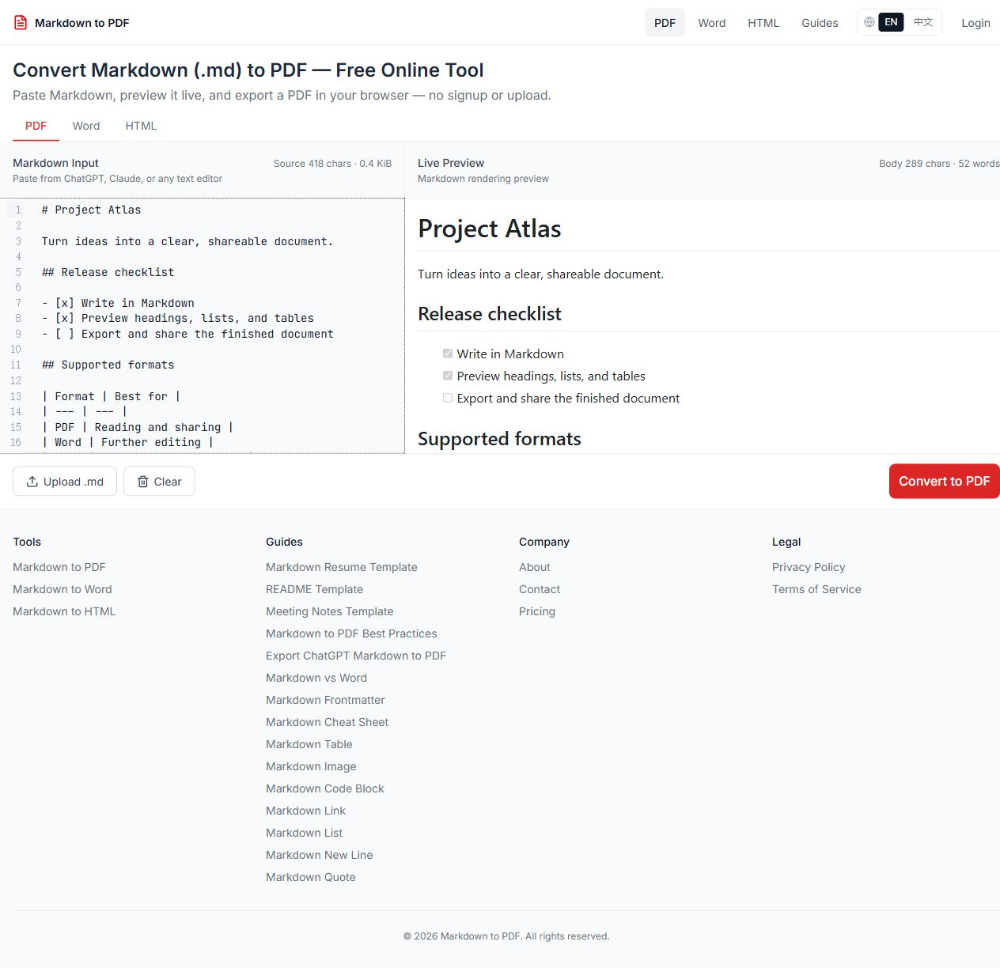
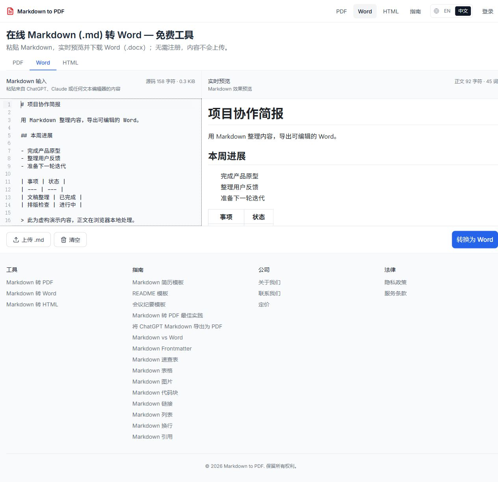

# Markdown to PDF

Convert Markdown to PDF, Word, and HTML entirely in your browser.

[English](./README.md) · [简体中文](./README.zh.md)

> **Hosted-service retirement — November 16, 2026.** The original hosted service at `markdown-to-pdf.app` has been retired. The source code, commit history, screenshots, and self-hosting instructions remain available under the MIT license. Issues and pull requests remain open. Deployment status is recorded in [the retirement notice](./docs/RETIREMENT.md).
>
> For a standalone, offline **Markdown-to-Word** tool, see [Lighter · MD to Word](https://github.com/BBS6215/lighter-md-to-word). Lighter exports Word documents; it does not replace this project's PDF or HTML features.

## Screenshots

Real screenshots of the original website, captured before shutdown on November 16, 2026 with fictional sample text. They are stored in this repository and remain available after the domain expires.

**English PDF converter**



**Chinese Word converter**



## What it does

Paste Markdown (or upload a `.md` file) → preview live → export as:

- **PDF** — via the browser's native print engine (`window.print()` against a hidden iframe)
- **Word** — via [`docx`](https://www.npmjs.com/package/docx) `Packer.toBlob()` with a Microsoft YaHei base font, tuned for both CJK and Latin content
- **HTML** — sanitized, copy-to-clipboard for pasting into Notion / Google Docs / email

Built for English-speaking AI tool users who get Markdown from ChatGPT / Claude / Gemini and need a clean, distributable document.

## Architecture (TL;DR)

**Pure-frontend pipeline.** No backend. Conversions run entirely in the user's browser.

```
Next.js (Vercel)  ──►  unified (remark + rehype-sanitize)  ──►  PDF / Word / HTML
                                       │
                                       └──►  Supabase  (Auth + conversion_history log)
```

- Hosting and database costs depend on your own account, plan, region, and domain; historical cost notes are not a quote for a new deployment
- No quota, no rate limit
- See [`docs/10-前端化架构补丁.md`](./docs/10-前端化架构补丁.md) for the architecture pivot rationale (this project initially designed a Render-backed Puppeteer service; that path is preserved in `backend/` but not deployed)

## Tech stack

| Layer | Choice |
|---|---|
| Framework | Next.js 15 (App Router, React 19) |
| Language | TypeScript 5.7+ |
| Styling | Tailwind CSS 4 |
| Editor | CodeMirror 6 |
| Markdown | `unified` + `remark-gfm` + `rehype-sanitize` |
| Word | `docx` 9.x |
| Auth + DB | Supabase |
| Hosting | Vercel |
| Package manager | pnpm 10 (workspaces) |
| Node | 22.x |

## Quick start

```bash
# 1. Install the frontend with the committed dependency versions
pnpm install --frozen-lockfile --filter @mdpdf/frontend...

# 2. Configure environment variables BEFORE dev or production build
cp frontend/.env.example frontend/.env.local
#    Fill in NEXT_PUBLIC_SUPABASE_URL and NEXT_PUBLIC_SUPABASE_ANON_KEY
#    (see frontend/.env.example for where to find them)

# 3. Dev (frontend only)
pnpm dev
# → http://localhost:3000

# 4. Typecheck + lint
pnpm typecheck
pnpm lint
pnpm test

# 5. Production build (requires both Supabase public variables from step 2)
pnpm build
```

### Reproducible quality checks and CI builds

Use `pnpm lint` (not a bare global ESLint command). The project entrypoint resolves plugins and parsers from this project and the Next preset's declared dependencies, so it also works without pnpm dependency hoisting. The ESLint presets and rule versions are unchanged.

`pnpm build` loads production dotenv files using Next's normal precedence, then checks `NEXT_PUBLIC_SUPABASE_URL` and `NEXT_PUBLIC_SUPABASE_ANON_KEY` before compilation. Provide them in `frontend/.env.local` or the CI process environment. They are build-time inputs baked into client bundles; setting them only after building is insufficient.

For an **offline compile-only CI check**, explicit placeholders can be used:

```bash
NEXT_PUBLIC_SUPABASE_URL=https://example.supabase.co \
NEXT_PUBLIC_SUPABASE_ANON_KEY=offline-build-test-key pnpm build
```

These values do not validate OAuth/history/RLS and must not be used for production or Preview deployments. Deployment builds require the real project's public configuration; never use a service-role key. Missing values fail immediately with variable names only. See [DEPLOY section C](./docs/DEPLOY.md#c-环境变量).

## Repository layout

```
markdown-to-pdf-app/
├── frontend/            # Next.js app (deployed to Vercel)
│   ├── app/             # App Router pages (i18n: /en, /zh)
│   ├── components/      # UI components
│   ├── lib/
│   │   ├── converter/   # PDF / Word / HTML browser-side exporters
│   │   ├── markdown/    # unified render pipeline
│   │   └── seo/         # metadata, sitemap helpers
│   └── ...
├── backend/             # Express + Puppeteer — NOT DEPLOYED (cold storage)
├── shared/              # Cross-package types
├── supabase/            # SQL migrations
└── docs/                # Design + architecture docs (Chinese, see index below)
```

## Documentation index (Chinese)

The original design docs are in Chinese. Architecture summary in English is above.

| # | Doc | Status |
|---|---|---|
| **00** | **[Document index & Definition of Done](./docs/00-文档索引与完成定义.md)** | ✅ **Governance and delivery gates** |
| 01 | [项目主线文档](./docs/01-项目主线文档.md) | ✅ Active |
| 02 | [SEO 策略与搜索需求](./docs/02-SEO策略与搜索需求设计说明.md) | ✅ Active |
| 03 | [产品结构文档](./docs/03-产品结构文档.md) | ✅ Active |
| 03-1 | [交互与体验补充](./docs/03-1-交互与体验补充说明.md) | ✅ Active |
| 04 | [UI 设计与视觉规范](./docs/04-UI设计与视觉规范建议.md) | ✅ Active |
| 05 | [技术方案文档](./docs/05-技术方案文档.md) | 🗄 Historical baseline; architecture superseded by 10 |
| 06 | [数据库设计说明](./docs/06-数据库设计说明.md) | ⚠️ Quota flow superseded by 10 |
| 07 | [开发方案与实施步骤](./docs/07-开发方案与实施步骤说明.md) | 🗄 Historical implementation baseline |
| 08 | [安全设计补丁](./docs/08-安全设计补丁.md) | ⚠️ §3 active, §4-5 obsolete |
| 09 | [服务端权威用量补丁](./docs/09-服务端权威用量补丁.md) | ❌ Entirely obsolete |
| **10** | **[前端化架构补丁](./docs/10-前端化架构补丁.md)** | ✅ **Current architecture** |
| ★ | **[DEPLOY.md](./docs/DEPLOY.md)** | ✅ **Production deployment runbook** |

## Deployment

Use your own hosting, database, credentials, and domain. The retired service's Supabase project and Google login configuration are not reusable.

1. Create your own Supabase project. Apply the seven SQL migrations in filename order; see [Supabase schema instructions](./supabase/README.md).
2. Set your own `NEXT_PUBLIC_SUPABASE_URL` and `NEXT_PUBLIC_SUPABASE_ANON_KEY` before development or production builds. Never put a service-role key or Google client secret in frontend variables.
3. Deploy only `frontend/` to Vercel or another compatible Next.js host. The Express/Puppeteer `backend/` directory is historical and is not needed for the current conversion pipeline.
4. Configure Supabase's Site URL and redirect allowlist for your domain. To enable Google sign-in, create your own Google OAuth web client, register `https://<your-project-ref>.supabase.co/auth/v1/callback`, and configure the Google provider in Supabase. No Google client secret belongs in Git.
5. Before publishing, replace the original domain in SEO metadata, sitemap, robots, structured data, and contact/legal pages, and remove or replace the original AdSense publisher identifier. Run `rg -n 'markdown-to-pdf\.app|ca-pub-' frontend` to find these references. `NEXT_PUBLIC_SITE_URL` alone does **not** update the hard-coded SEO URLs.
6. Verify PDF printing, Word export, HTML copying, and any login/history features you enable.

[`docs/DEPLOY.md`](./docs/DEPLOY.md) preserves the original deployment runbook for reference. Its former project names, credentials, domain bindings, and historical operational results do not describe a new deployment.

## Feedback and maintenance

Issues and pull requests are welcome. The original hosted service will not be operated from this repository. Please use synthetic examples in bug reports and never upload private documents, account data, or credentials.

## License

MIT — see [LICENSE](./LICENSE). Bundled fonts use SIL OFL 1.1; see [third-party notices](./THIRD_PARTY_NOTICES.md).


## Reliability and performance update (2026-10-04)

The converter now shows source/body statistics, preserves nested Word lists and task states, handles BOM/legacy text files without browser Buffer dependencies, and provides real retries with one action lock. Preview uses a UTF-8-safe 200KiB excerpt; exports still use the complete input. Draft checkpoints are debounced and flushed before navigation.

Markdown rendering and body segmentation run in a Worker with a safe fallback. Unlabelled code no longer triggers language detection. Public localized pages are statically rendered; Dashboard remains private/dynamic. Next.js 15 globalNotFound is enabled for the multiple root layouts. See docs/10 section 9 and DEPLOY section K for validation and remaining device/auth checks.
