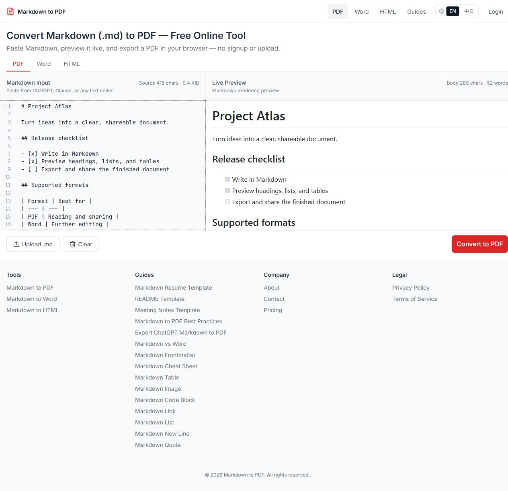
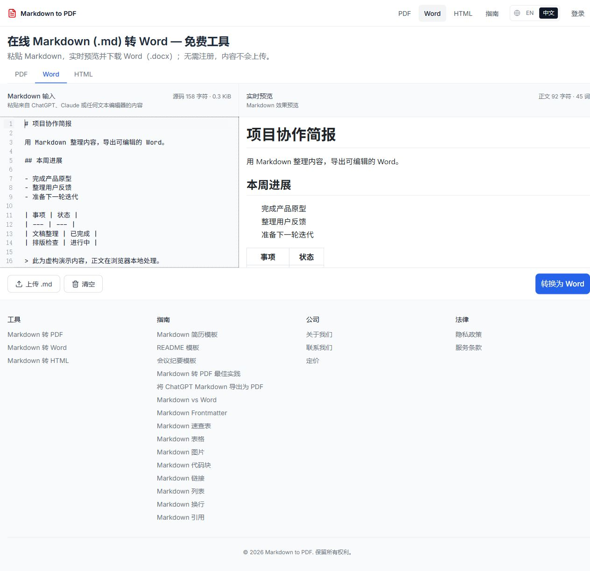

# Markdown to PDF

在浏览器本地将 Markdown 转成 PDF、Word 和 HTML。

[English](./README.md) · [简体中文](./README.zh.md)

> **线上服务退出说明（2026-11-16）：** 原站 `markdown-to-pdf.app` 已停止运营。代码、Git 历史、截图和自行部署说明继续以 MIT 许可公开保留，Issues 和 PR 继续开放。实际处置状态见[退出说明](./docs/RETIREMENT.md)。
>
> 如需单文件、离线使用的 **Markdown 转 Word** 工具，可使用 [Lighter · MD to Word](https://github.com/BBS6215/lighter-md-to-word)。Lighter 提供 Word 导出，不覆盖本项目的 PDF 和 HTML 功能。

## 网站截图

以下为 2026-11-16 停服前从真实网站截取的页面，使用虚构演示内容。图片随仓库保存，域名失效后仍可查看。

**英文 PDF 转换页**



**中文 Word 转换页**



## 项目定位

粘贴 Markdown（或拖入 `.md` 文件）→ 实时预览 → 一键导出：

- **PDF** — 通过浏览器原生打印引擎（`window.print()` + 隐藏 iframe）
- **Word** — 通过 [`docx`](https://www.npmjs.com/package/docx) 包 `Packer.toBlob()`，基础字体微软雅黑，中文 / 英文都能干净渲染
- **HTML** — Sanitize 之后写入剪贴板，方便粘贴到 Notion / 飞书 / 邮件

目标用户是被 ChatGPT / Claude / Gemini 塞了一堆 Markdown 的海外用户，需要一个能转成可分发文档的工具。

## 当前架构（一句话版）

**纯前端管道，无 backend**。所有格式转换在用户浏览器本地完成。

```
Next.js (Vercel)  ──►  unified (remark + rehype-sanitize)  ──►  PDF / Word / HTML
                                       │
                                       └──►  Supabase  (Auth + 历史记录)
```

- 自行部署费用取决于自己的托管、数据库套餐、地区和域名；历史成本说明不代表当前部署报价
- 无配额、无限流
- 架构变迁记录详见 [`docs/10-前端化架构补丁.md`](./docs/10-前端化架构补丁.md)（项目最初设计了 Render + Puppeteer 后端，那条路径 `backend/` 代码保留作冷备，未部署）

## 技术栈

| 层 | 选型 |
|---|---|
| 框架 | Next.js 15（App Router + React 19） |
| 语言 | TypeScript 5.7+ |
| 样式 | Tailwind CSS 4 |
| 编辑器 | CodeMirror 6 |
| Markdown | `unified` + `remark-gfm` + `rehype-sanitize` |
| Word | `docx` 9.x |
| Auth + DB | Supabase |
| 部署 | Vercel |
| 包管理 | pnpm 10（workspaces） |
| Node | 22.x |

## 快速开始

```bash
# 1. 安装依赖
pnpm install --frozen-lockfile --filter @mdpdf/frontend...

# 2. 复制环境变量模板
cp frontend/.env.example frontend/.env.local
#    填入 NEXT_PUBLIC_SUPABASE_URL 和 NEXT_PUBLIC_SUPABASE_ANON_KEY
#    （在哪找见 frontend/.env.example 的注释）

# 3. 跑开发服（仅前端）
pnpm dev
# → http://localhost:3000

# 4. 类型检查 + lint
pnpm typecheck
pnpm lint
pnpm test

# 5. 生产构建
pnpm build
```

## 本地与 CI 的验证前置条件

- 构建前必须配置 `NEXT_PUBLIC_SUPABASE_URL` 和 `NEXT_PUBLIC_SUPABASE_ANON_KEY`：本地复制模板到 `frontend/.env.local`，CI在运行 `pnpm build` 前注入环境变量。只在启动服务器时设置不够，公开变量会写入客户端构建产物。
- `pnpm build` 按Next生产环境的dotenv优先级读取配置，然后执行缺值检查；缺失时在编译开始前退出，只输出变量名和配置位置。
- lint统一使用 `pnpm lint`。入口为子进程明确提供项目和Next预设自身的依赖路径，默认安装及禁用提升的安装均可用；原ESLint配置、规则和版本保持不变，不依赖全局eslint或隐式NODE_PATH。
- 仅做离线编译验证的CI可使用明确的占位配置，示例见 [DEPLOY第C节](./docs/DEPLOY.md#c-环境变量)。占位值不能验证OAuth、历史写入或RLS，也不能用于生产/Preview部署；部署必须使用真实项目的公开配置，不使用service_role。

## 仓库结构

```
markdown-to-pdf-app/
├── frontend/            # Next.js 应用（部署到 Vercel）
│   ├── app/             # App Router 页面（i18n: /en, /zh）
│   ├── components/      # UI 组件
│   ├── lib/
│   │   ├── converter/   # 三种格式的浏览器端导出器
│   │   ├── markdown/    # unified 渲染管道
│   │   └── seo/         # metadata、sitemap 工具
│   └── ...
├── backend/             # Express + Puppeteer，未部署（冷备）
├── shared/              # 跨包共享类型
├── supabase/            # SQL 迁移
└── docs/                # 设计 + 架构文档（中文，见下表索引）
```

## 文档索引

| 编号 | 文档 | 状态 |
|---|---|---|
| **00** | **[文档索引与完成定义](./docs/00-文档索引与完成定义.md)** | ✅ **项目治理与交付门禁** |
| 01 | [项目主线文档](./docs/01-项目主线文档.md) | ✅ 有效 |
| 02 | [SEO 策略与搜索需求](./docs/02-SEO策略与搜索需求设计说明.md) | ✅ 有效 |
| 03 | [产品结构文档](./docs/03-产品结构文档.md) | ✅ 有效 |
| 03-1 | [交互与体验补充](./docs/03-1-交互与体验补充说明.md) | ✅ 有效 |
| 04 | [UI 设计与视觉规范](./docs/04-UI设计与视觉规范建议.md) | ✅ 有效 |
| 05 | [技术方案文档](./docs/05-技术方案文档.md) | 🗄 历史基线；架构已被 10 覆盖 |
| 06 | [数据库设计说明](./docs/06-数据库设计说明.md) | ⚠️ 配额流被 10 覆盖 |
| 07 | [开发方案与实施步骤](./docs/07-开发方案与实施步骤说明.md) | 🗄 历史实施基线 |
| 08 | [安全设计补丁](./docs/08-安全设计补丁.md) | ⚠️ §3 生效，§4-5 失效 |
| 09 | [服务端权威用量补丁](./docs/09-服务端权威用量补丁.md) | ❌ 整体失效 |
| **10** | **[前端化架构补丁](./docs/10-前端化架构补丁.md)** | ✅ **当前架构权威** |
| ★ | **[DEPLOY.md](./docs/DEPLOY.md)** | ✅ **生产部署 runbook** |

## 部署

请使用自己的托管、数据库、凭据和域名。原站的 Supabase 项目及 Google 登录配置不再提供使用。

1. 创建自己的 Supabase 项目，按文件名顺序执行七份 SQL 迁移，参见[数据库说明](./supabase/README.md)。
2. 在开发或构建前配置自己的 `NEXT_PUBLIC_SUPABASE_URL` 和 `NEXT_PUBLIC_SUPABASE_ANON_KEY`。前端变量中不得放入 service-role 密钥或 Google 客户端密钥。
3. 在 Vercel 或兼容的 Next.js 平台部署 `frontend/`。当前转换无需启动历史 `backend/` 中的 Express/Puppeteer 服务。
4. 为自己的域名设置 Supabase Site URL 和重定向白名单。若启用 Google 登录，创建自己的 Google OAuth Web 客户端，登记 `https://<自己的项目ref>.supabase.co/auth/v1/callback`，再将客户端配置填入 Supabase Google Provider。Google 客户端密钥不得提交到 Git。
5. 发布前替换 SEO 元数据、站点地图、robots、结构化数据、联系与法律页面中的原域名，并移除或替换原 AdSense 发布者标识。可运行 `rg -n 'markdown-to-pdf\.app|ca-pub-' frontend` 查找引用。仅设置 `NEXT_PUBLIC_SITE_URL` **不会**自动更新写死的 SEO 网址。
6. 验证 PDF 打印、Word 导出、HTML 复制，以及自己启用的登录与历史功能。

[`docs/DEPLOY.md`](./docs/DEPLOY.md) 保留原部署过程供参考。其中的旧项目名、凭据、域名绑定和历史验收记录不能直接视为新部署的配置或验证结果。

## 反馈与维护

欢迎提交 Issues 和 PR；本仓库不再运营原线上服务。报告问题请使用虚构示例，勿上传真实材料、账号数据或凭据。

## License

MIT —— 见 [LICENSE](./LICENSE)。内嵌字体适用 SIL OFL 1.1，详见[第三方许可说明](./THIRD_PARTY_NOTICES.md)。


## 可靠性与性能更新（2026-10-04）

左右分别显示源码/正文统计；Word保留嵌套、任务及引用内内容；上传支持BOM及检测到的旧编码，浏览器不再依赖Buffer；重试实际重做且各动作共用锁。预览按UTF-8限制为200KiB片段，导出仍为全文，草稿防抖保存并在导航前flush。

Markdown解析与正文分词进入Worker，故障时回退相同安全管线；未标注代码不再自动猜测语言。公共语言页面静态生成，Dashboard仍私有/动态。多根布局采用Next15实验globalNotFound；验证与未覆盖项见10号文档第9节及DEPLOY第K节。
